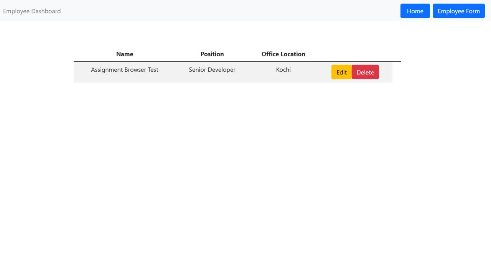

# Assignment 3 — Employee App Backend Integration

Employee CRUD application using Express, Mongoose, MongoDB Atlas, and the supplied Angular production build.

All backend implementation is in **app.js**. Every original starter line is preserved in its original order. The supplied **dist/** files are unchanged. The original static middleware is retained, with an additional correctly capitalized `Frontend` path for Linux compatibility.

## Run locally

Requires Node.js 22 or newer and a MongoDB Atlas connection.

```powershell
npm ci
Copy-Item .env.example .env
# Set your Atlas connection string in .env.
npm start
```

Open http://localhost:3000. The same Express server serves both the frontend and API. There is no frontend build step.

| Environment variable | Purpose |
| --- | --- |
| `MONGODB_URI` | Your Atlas connection string; required |
| `MONGODB_DB` | Database name; defaults to `employee_app_assignment3` |
| `PORT` | HTTP port; defaults to `3000` |
| `DNS_SERVERS` | Optional comma-separated DNS resolvers for Atlas SRV resolution |

In Atlas, grant your database user `readWrite` on `employee_app_assignment3`, allow your computer's IP under Network Access, and use the driver's connection string. URL-encode special characters in the username/password. The application connects to Atlas before starting the HTTP server. Employees are stored in the `employees` collection.

The local `.env` and installed `node_modules` are excluded from Git. Never commit database credentials. Use your own `.env` after cloning.

## API

| Method | Endpoint | Result |
| --- | --- | --- |
| GET | `/api/employeelist` | All employees as a JSON array |
| GET | `/api/employeelist/:id` | One employee as a JSON object |
| POST | `/api/employeelist` | Create an employee; HTTP 201 |
| PUT | `/api/employeelist` | Update the employee identified by body `_id` |
| PUT | `/api/employeelist/:id` | Update by path id; also supported |
| DELETE | `/api/employeelist/:id` | Delete one employee |

POST body:

```json
{
  "name": "Sample Employee",
  "location": "Kochi",
  "position": "Developer",
  "salary": "42000"
}
```

For the frontend's PUT endpoint, include the `_id` returned by GET, plus all four employee fields. Names, locations, and positions must be nonempty strings of at most 120 characters. Salary accepts a number or numeric string and must be finite and nonnegative; it is stored as a number. Only these four fields are written to the database.

Errors return JSON with a `message`: invalid data/ids or malformed JSON use 400, missing employees or unknown API paths use 404, oversized bodies use 413, database interruptions use 503, and unexpected server errors use 500. Angular deep links continue to serve the original index page.

## Verification

`npm run check` checks the backend syntax. The submission is also checked against the starter ZIP to confirm unchanged frontend file hashes and preservation of all original `app.js` lines. Live CRUD and persistence checks use a separate assignment database and remove their temporary records.

All 12 live API checks passed, including create, list, fetch one, both update routes, input validation, malformed JSON, missing records, static assets, restart persistence, and deletion. Results are recorded in [docs/verification.json](docs/verification.json). Browser testing also confirmed adding an employee, loading its edit form, updating it, and rendering the result using the unchanged supplied frontend.



Express 4 is used to retain compatibility with the supplied `app.get('/*', ...)` route. Update operations explicitly enable [Mongoose validation](https://mongoosejs.com/docs/validation.html).
